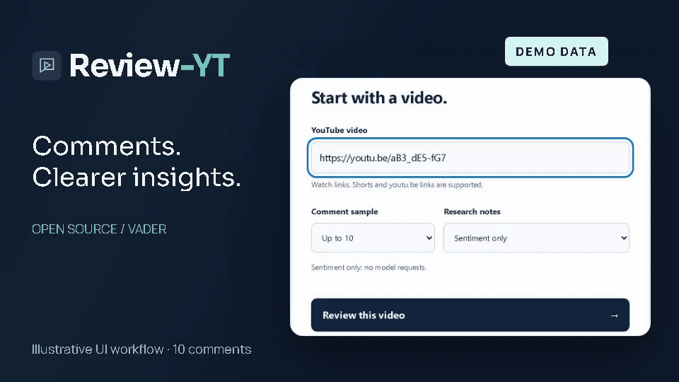
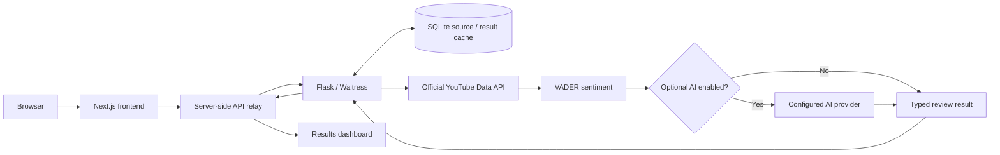

# Review-YT

**Open-source YouTube comment sentiment analysis and insights.**

[](https://github.com/YellankiKaushik/Review-YT/actions/workflows/verify.yml)
[](LICENSE)
[](apps/web/package.json)
[](packages/review_yt_core/pyproject.toml)

Review-YT takes a public YouTube video link, retrieves a bounded sample of genuine comments using **your own YouTube Data API key**, and shows their estimated tone in a responsive dashboard. VADER produces the sentiment counts; optional AI adds separate, attributed research notes.

> Review-YT is maintained as a public source-code project. The original maintainer's hosted demo has been retired. You can run the application locally or deploy your own instance using the guides below.

[Get started](docs/GETTING_STARTED.md) · [Deploy your own](docs/SELF_HOSTING.md) · [Documentation](docs/README.md) · [Troubleshooting](docs/TROUBLESHOOTING.md)

## Watch Review-YT in Action

[](promo/output/review-yt-youtube-1080p.mp4)

A short look at the self-hostable workflow. **Result footage uses illustrative demo data, not live YouTube feedback.**

[70-second launch film](promo/output/review-yt-youtube-1080p.mp4) · [Vertical reel](promo/output/review-yt-reel-vertical.mp4) · [Silent MP4 preview](promo/output/review-yt-github-preview.mp4) · [Production source and rendering guide](promo/README.md)

## Preview

These are genuine application captures. **Result screenshots contain clearly labeled illustrative DEMO data and original artwork, not real public YouTube feedback.** [Capture method and provenance](docs/assets/README.md).


<details>
<summary>Mobile results dashboard</summary>


</details>

## Features

| Feature | What is implemented |
| --- | --- |
| Genuine sources | Official YouTube video metadata and a bounded top-level comment sample; no silent demo fallback. |
| Transparent sentiment | VADER positive/neutral/negative counts and percentages based on the actual retrieved sample. |
| Analytics UI | Responsive dashboard, labeled chart, video metadata, keyboard focus and reduced-motion support. |
| Saved results | Temporary SQLite source/result caches and provider-specific tab storage; reload and result links are cache-only. |
| Optional AI | Ollama, OpenRouter, OpenAI, Gemini and Groq adapters with actual returned-model attribution and safe failure isolation. Availability and price depend on the operator's account. |
| Optional captions | Opt-in public English transcript retrieval; excerpts and failures are disclosed. |
| Recovery | Clear input, connection, unavailable-provider, storage and expired-cache states. |
| Server-only credentials | Authenticated Flask backend behind a Next server relay; keys stay out of browser variables. |

**Sentiment-only is the default.** Paid inference and automatic fallback are disabled. You need your own YouTube key for real comments, but no cloud account or real key is required for the offline tests. [AI support and evidence](docs/OPTIONAL_AI_PROVIDERS.md).

## Quick start

Use **Python 3.12** (CI pins 3.12.15), **Node.js 24**, npm and Git. The core declares Python >=3.11 and the npm manifest Node >=22; the documented/tested full-stack baseline is Python 3.12 + Node 24.

```bash
git clone https://github.com/YellankiKaushik/Review-YT.git
cd Review-YT
```

Windows PowerShell:

```powershell
py -3.12 -m venv .venv
.\.venv\Scripts\python.exe -m pip install -r requirements-dev.txt
npm ci
if (!(Test-Path .env)) { Copy-Item .env.example .env }
if (!(Test-Path apps/web/.env.local)) { Copy-Item apps/web/.env.example apps/web/.env.local }
```

Linux/macOS:

```bash
python3.12 -m venv .venv
.venv/bin/python -m pip install -r requirements-dev.txt
npm ci
test -f .env || cp .env.example .env
test -f apps/web/.env.local || cp apps/web/.env.example apps/web/.env.local
```

Privately fill `YOUTUBE_API_KEY` in root `.env`, generate a random `BACKEND_API_TOKEN`, and put the **same token** in `apps/web/.env.local`. Its `BACKEND_URL` is `http://127.0.0.1:5100`. [YouTube key setup](docs/YOUTUBE_API_SETUP.md) · [All configuration](docs/CONFIGURATION.md).

## Running locally

From the root, use two terminals:

```powershell
# Windows, terminal 1
.\.venv\Scripts\python.exe apps/api/serve.py
```

```bash
# Linux/macOS, terminal 1
.venv/bin/python apps/api/serve.py
```

```bash
# All platforms, terminal 2
npm run dev
```

Open **http://127.0.0.1:3200**. Backend health is **http://127.0.0.1:5100/health**. Stop manual processes with Ctrl+C in each terminal. Windows also has guarded [start/check/stop scripts](docs/LOCAL_STARTUP.md). [The beginner guide](docs/GETTING_STARTED.md) explains every step, success indicators and safe shutdown.

## Architecture



The browser uses same-origin Next routes; only servers know the shared backend token. Cached results are checked before fresh retrieval, and optional AI failure preserves VADER. Any suitable host can run these components. The preserved diagram below illustrates the **optional Render/Vercel hosting pattern**, not a required vendor or a currently operated service.


## Technology stack

| Layer | Actual implementation |
| --- | --- |
| Frontend | Next.js 16.4.2, React 19.3.1, TypeScript 5.9.3, original CSS and lightweight chart |
| Backend | Python, Flask and Waitress; framework-independent `review_yt_core` library |
| Sentiment | vaderSentiment 3.3.2; English lexicon rules |
| Storage | Bounded SQLite source/result caches; browser tab session storage |
| AI | Optional operator-configured providers; no model weights bundled |
| Testing | pytest, Vitest, Testing Library and Playwright Chromium |
| Automation | Pinned, read-only GitHub Actions; offline fixtures |
| Deployment | Native server operation; optional Render/Vercel templates |

Versions come from [npm manifests](apps/web/package.json), the authoritative [root lockfile](package-lock.json), [Python runtime lock](requirements-runtime.lock) and [core metadata](packages/review_yt_core/pyproject.toml).

## Documentation

| Guide | Use it for |
| --- | --- |
| [Getting started](docs/GETTING_STARTED.md) | Fresh clone, installation, configuration, first analysis and stopping |
| [YouTube API setup](docs/YOUTUBE_API_SETUP.md) | Your own project/key, restrictions, quotas and failures |
| [Configuration](docs/CONFIGURATION.md) | Every supported application setting, defaults and secret placement |
| [Self-hosting](docs/SELF_HOSTING.md) | Private server or your own Render/Vercel instance |
| [Render](docs/RENDER_DEPLOYMENT_HANDOFF.md) / [Vercel](docs/VERCEL_DEPLOYMENT_HANDOFF.md) | Exact optional deployment settings |
| [Optional AI](docs/OPTIONAL_AI_PROVIDERS.md) | Provider configuration, safety and evidence limits |
| [Troubleshooting](docs/TROUBLESHOOTING.md) | Common installation, API, cache and deployment errors |
| [API](docs/API.md) | Requests, responses and failure contracts |
| [Developer QA](docs/development/PRODUCT_QA.md) | Full checks, responsive regressions and captures |
| [All documentation](docs/README.md) | Current instructions and separately labeled historical evidence |

## Deploy your own instance

Fork this repository and use **your own accounts, YouTube key, random backend token and domains**. [Self-hosting](docs/SELF_HOSTING.md) covers local/private servers and optional Render + Vercel. The committed templates contain no working account credentials. Free plans may sleep, impose quotas and lose ephemeral SQLite data; verify current terms and operating costs before deployment. This release does not create or restore hosting resources.

## Tests and quality

From the root (replace the Python executable with `.venv/bin/python` on POSIX):

```powershell
.\.venv\Scripts\python.exe -m pytest -q
npm run lint
npm run typecheck
npm test
npm run build
npx playwright install chromium
npm run test:e2e
.\.venv\Scripts\python.exe scripts/verify.py
```

The aggregate verifier also runs Ruff, the independent wheel/sdist build, dependency audits, release-configuration checks, documentation links, source inventory and secret/history scanning. It stops on failure and stores ignored diagnostic logs. [Pinned Ubuntu CI](.github/workflows/verify.yml) installs Chromium with its OS dependencies. Tests use explicit dependency-injected fixtures, **not real YouTube or AI requests**.

The 2026-10-21 release previously passed **230 tests (137 Python, 51 frontend, 42 browser)**. Current source-only verification and fresh-install results are recorded separately in [the handoff report](FINAL_OPEN_SOURCE_RELEASE_REPORT.md); this historical count is not a claim that every future checkout passes.

## API overview

| Method | Backend route | Behavior |
| --- | --- | --- |
| GET | `/health` | Liveness and contract; does not validate upstream credentials |
| GET | `/api/providers` | Authenticated configured-provider inventory; availability is not guaranteed inference |
| POST | `/api/analyze` | Validates video, sample (1–500) and enabled provider, then returns genuine analysis |
| GET | `/api/results` | Cache-only lookup; never fetches comments or invokes models |

Next relays the three `/api/*` routes server-side. [Full contract](docs/API.md).

## Security

Keep all keys and `BACKEND_API_TOKEN` server-only, out of Git, issue bodies, logs and `NEXT_PUBLIC_*` variables. The token must match between Flask and Next; `BACKEND_URL` must be your own trusted origin and use HTTPS in production. Public binding refuses missing key/token configuration. Existing rate, body, timeout and retention limits are safeguards, not a distributed abuse-prevention service or security certification. Read [SECURITY.md](SECURITY.md).

## Limitations

- VADER is English-oriented and may misread sarcasm, context and mixed languages.
- A bounded top-level comment sample is not representative of every viewer or reply.
- YouTube quotas, restrictions, unavailable videos and disabled comments affect retrieval.
- Cached data expires and ephemeral storage can disappear; saved reviews are not permanent records.
- AI may fail, require payment, be rate-limited or generate incorrect notes. It is optional.
- Captions are opt-in and may be missing or truncated; access controls are never bypassed.

## Contributing, maintenance and license

This project is preserved as an open-source portfolio and reference implementation. Contributions may be considered as time permits. The original maintainer does not operate a public demo or guarantee ongoing support.

Read [CONTRIBUTING.md](CONTRIBUTING.md) before submitting a focused, tested PR. Report problems without secrets or private comment bodies. Maintainer: [YellankiKaushik](https://github.com/YellankiKaushik) · [Repository](https://github.com/YellankiKaushik/Review-YT).

[MIT](LICENSE) applies **only to eligible new project material**. [NOTICE](NOTICE), [third-party notices](docs/THIRD_PARTY_NOTICES.md), all retained legal texts and the [recorded rights decision](docs/FINAL_PUBLICATION_RIGHTS_CHECKLIST.md) preserve the separate rights/terms of dependencies and historical work. Comments, captions, thumbnails, model weights and live output are not a bundled dataset or a new MIT grant. Provenance limitations remain disclosed in [the audit](docs/INDEPENDENT_IMPLEMENTATION_AUDIT.md).

[Dated release records](docs/reports/archive/README.md) describe former deployments as historical evidence; they are not current application destinations.
