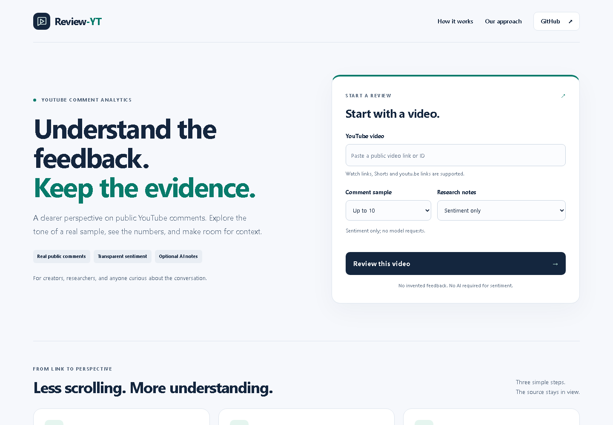
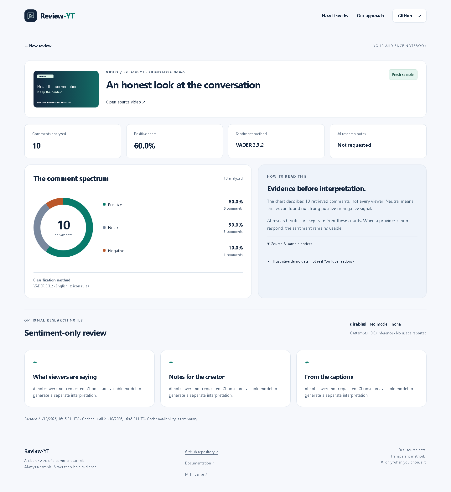
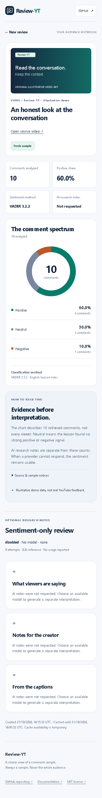
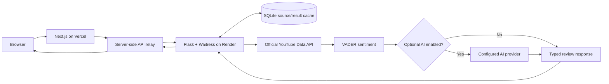
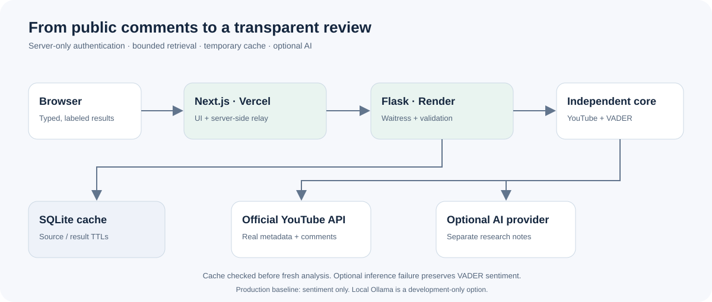

# Review-YT

**Understand public YouTube comments through transparent sentiment analysis.**

[](https://github.com/YellankiKaushik/Review-YT/actions/workflows/verify.yml)
[](LICENSE)
[](apps/web/package.json)
[](packages/review_yt_core/pyproject.toml)

Review-YT retrieves a bounded sample of actual public comments, estimates their tone with VADER, and presents the counts in an accessible dashboard. Optional AI research notes add a separate, attributed interpretation. The sentiment result remains useful when AI is unavailable.

**[Open the live application](https://review-yt.vercel.app)** · [Backend health](https://review-yt-api.onrender.com/health) · [Documentation](docs/README.md) · [API](docs/API.md)

The application is deployed on **Vercel + Render**. The hosted baseline is **sentiment-only**; it does not require or promise AI summaries. Homepage, backend health and provider inventory were verified over HTTPS on 2026-10-21. Exact release checks and rollout status are in the [polish report](FINAL_REVIEW_YT_POLISH_REPORT.md).

## Contents

[Preview](#product-preview) · [Features](#features) · [Architecture](#architecture) · [Stack](#technology-stack) · [Setup](#getting-started) · [Environment](#environment-variables) · [Testing](#tests-and-quality) · [Deployment](#deployment) · [API](#api-overview) · [Security](#security) · [Limitations](#limitations) · [Contributing](#contributing)

## Product preview

These are genuine browser captures of the application. **Result previews use clearly labeled illustrative demo data and original video artwork, not actual YouTube feedback.** No public comment bodies, user identities or secrets are included. [Capture method and provenance](docs/assets/README.md).





<details>
<summary>View the mobile results dashboard</summary>



</details>

## Features

| Capability | What it actually does |
| --- | --- |
| Public YouTube input | Accepts watch, Shorts, live, embed and youtu.be links, or an eleven-character video ID. |
| Real source retrieval | Uses the official YouTube Data API for video metadata and top-level public comments. The form offers 10–500 comments; the actual retrieved count is shown. |
| Transparent sentiment | VADER classifies the sampled text into positive, neutral and negative counts. Text labels, counts and percentages complement the color chart. |
| Optional AI | Configured providers can supply comment digests, creator research notes and caption summaries. Actual returned model identity, usage and failures are displayed separately. |
| Optional captions | Public transcript retrieval is opt-in and may be unavailable. It is disabled in the production baseline. |
| Temporary caching | Bounded SQLite source/result caches and tab session storage avoid unnecessary analysis while saved entries remain available. |
| Error recovery | Clear validation, timeout, unavailable-provider and expired-cache states; no hidden regeneration through result links. |
| Responsive interface | Keyboard focus, labeled controls, reduced-motion support and layouts tested from 375 to 1920 pixels. |

Ollama/Gemma is a **local development** integration. OpenRouter, OpenAI, Gemini and Groq are optional operator-configured adapters, not promises of free or continuously available hosted inference. Paid inference and automatic fallback are disabled by default. Previous live-provider evidence is retained in the [historical reports](docs/reports/archive/README.md); automated fixtures are not presented as new live inference.

## Architecture



The browser uses same-origin Next routes. Only the server relay knows the backend token. Flask validates requests and coordinates the framework-independent core. Cached results are checked before fetching source; the diagram summarizes a fresh analysis. Optional model failure leaves the VADER baseline available. SQLite caches are bounded and ephemeral on free Render hosting.



## Technology stack

| Layer | Implementation |
| --- | --- |
| Frontend | Next.js 16.4.2, React 19.3.1, TypeScript, original CSS tokens and lightweight CSS chart |
| Backend | Python 3.12, Flask, Waitress |
| Sentiment | vaderSentiment 3.3.2; English lexicon rules |
| AI | Optional Ollama, OpenRouter, OpenAI, Gemini or Groq adapters; no model weights bundled |
| Data source | Official YouTube Data API; optional public transcript integration |
| Caching | SQLite with bounded source/result TTLs; tab session storage |
| Testing | pytest, Vitest, Testing Library, Playwright (Chromium desktop/mobile) |
| Deployment | Vercel frontend; Render native Python backend |
| CI/CD | Pinned GitHub Actions; offline deterministic checks; Vercel Git integration |

Package versions are recorded in the authoritative [npm lockfile](package-lock.json), [runtime lock](requirements-runtime.lock) and [core metadata](packages/review_yt_core/pyproject.toml).

## How it works

1. Paste a public video link and choose a comment limit and available provider.
2. The authenticated backend reuses a valid cache entry or retrieves metadata and a bounded public comment sample.
3. VADER calculates counts and percentages from the comments actually retrieved.
4. If explicitly selected and available, a model generates separate, attributed research notes.
5. The dashboard displays metadata, sentiment and optional notes. Reload/deep links read saved results without automatically launching another analysis.

## Getting started

Prerequisites: **Python 3.12**, **Node.js 24**, npm, and a privately configured **YouTube Data API v3 key**. Enable that API in your own Google Cloud project. Keep quotas and key restrictions appropriate to your backend.

```bash
git clone https://github.com/YellankiKaushik/Review-YT.git
cd Review-YT
python -m venv .venv
```

Windows PowerShell:

```powershell
.\.venv\Scripts\python.exe -m pip install -r requirements-dev.txt
npm ci
if (!(Test-Path .env)) { Copy-Item .env.example .env }
if (!(Test-Path apps/web/.env.local)) { Copy-Item apps/web/.env.example apps/web/.env.local }
```

POSIX:

```bash
.venv/bin/python -m pip install -r requirements-dev.txt
npm ci
test -f .env || cp .env.example .env
test -f apps/web/.env.local || cp apps/web/.env.example apps/web/.env.local
```

Fill the ignored private files before starting. These commands preserve existing environment files. Do not paste credentials into issues, screenshots or chat. npm workspaces use the root lockfile; use `npm ci` rather than creating a second lockfile under apps/web.

## Environment variables

| Context | Required settings | Safe baseline |
| --- | --- | --- |
| Local backend: root `.env` | YOUTUBE_API_KEY and a random private BACKEND_API_TOKEN | SUMMARY_PROVIDER=disabled; SUMMARY_ALLOW_PAID=false; SUMMARY_FALLBACK_ENABLED=false |
| Local frontend: `apps/web/.env.local` | BACKEND_URL=http://127.0.0.1:5100 and the matching BACKEND_API_TOKEN | Server-only variables; no NEXT_PUBLIC secrets |
| Render environment | YOUTUBE_API_KEY, BACKEND_API_TOKEN; platform PORT; HOST=0.0.0.0 | Sentiment-only, captions disabled, ephemeral CACHE_PATH |
| Vercel environment | BACKEND_URL=https://review-yt-api.onrender.com and matching BACKEND_API_TOKEN | Server-only; never copy local test/TLS settings |
| Optional providers | Appropriate provider key/model/allowlist, or loopback Ollama settings | Enable only deliberately; account/free-tier eligibility and provider terms apply |

See the complete [environment checklist](docs/ENVIRONMENT_VARIABLES_CHECKLIST.md) and committed example files. Never expose provider keys or the shared backend token to browser variables. This project does not download an Ollama model automatically.

## Running locally

In one terminal, from the repository root:

```powershell
.\.venv\Scripts\python.exe apps/api/serve.py
```

In a second terminal:

```bash
npm run dev
```

Open **http://127.0.0.1:3200**. The API listens on loopback port 5100. On POSIX replace the Python executable with `.venv/bin/python`. Windows users can use the guarded [start/check/stop scripts](docs/LOCAL_STARTUP.md), which refuse unknown occupied ports and do not adopt unrelated processes.

The [standalone Python core](packages/review_yt_core/README.md) can also be installed independently; Flask and Next.js are not its dependencies.

## Tests and quality

From the root (use `.venv/bin/python` on POSIX):

```powershell
.\.venv\Scripts\python.exe -m pytest -q
.\.venv\Scripts\python.exe -m ruff check packages apps tests scripts
npm run lint
npm run typecheck
npm test
npm run build
npm run test:e2e
.\.venv\Scripts\python.exe -m build packages/review_yt_core --outdir artifacts/package
npm audit --audit-level=high
.\.venv\Scripts\python.exe -m pip_audit --skip-editable
.\.venv\Scripts\python.exe scripts/check_docs.py
.\.venv\Scripts\python.exe scripts/secret_check.py
.\.venv\Scripts\python.exe scripts/verify.py
```

The verified published baseline passed **195 tests**. This redesign adds meaningful numerical-edge, focus/recovery and six-width browser regressions; current fresh counts and command outcomes are recorded in the [polish report](FINAL_REVIEW_YT_POLISH_REPORT.md), not inferred from that baseline. Browser CI uses an explicit offline Flask fixture on 5101 and a dedicated Next process on 3201. It does not consume live YouTube quotas or call cloud models.

For optimized local Next + Waitress + trusted loopback TLS:

```powershell
powershell -NoProfile -File scripts/test-production-local.ps1
```

This default makes no live analysis request and cleans up only its owned test processes. `-LiveYouTube` is an explicit bounded ten-comment opt-in. See the [QA/capture guide](docs/development/PRODUCT_QA.md).

## Deployment

The existing production frontend is [review-yt.vercel.app](https://review-yt.vercel.app), with backend [health](https://review-yt-api.onrender.com/health). A verified health response is not proof of an exact backend Git commit; deployment identity is checked separately where account metadata permits.

Vercel builds the apps/web workspace and keeps backend credentials server-side. Render runs Flask/Waitress with the sentiment-only baseline. The same private shared token is configured on both services; it is never sent to the browser. Free hosting may sleep and discard SQLite state.

Use the [current release procedure](docs/DEPLOYMENT.md), [Render settings](docs/RENDER_DEPLOYMENT_HANDOFF.md), [Vercel settings](docs/VERCEL_DEPLOYMENT_HANDOFF.md) and [environment checklist](docs/ENVIRONMENT_VARIABLES_CHECKLIST.md). Changes go through a tested branch, PR, CI and available preview checks. Render auto-deploy is disabled in the Blueprint; backend code changes require an explicitly verified manual deployment. Do not recreate existing services or change production secrets as a side effect of UI work.

## API overview

| Method | Backend route | Purpose |
| --- | --- | --- |
| GET | /health | Minimal health/contract metadata |
| GET | /api/providers | Configured provider inventory; backend authentication required |
| POST | /api/analyze | Validate a video, sample limit and enabled provider; return analysis |
| GET | /api/results | **Cache-only** lookup by video/provider; never starts analysis |

The browser uses Next's same-origin `/api/providers`, `/api/analyze` and `/api/results` relay routes. See [request/response contracts and errors](docs/API.md). Do not call the private backend directly from client components.

## Security

Credentials stay on the server. The API uses shared-token authentication, allowlisted request fields/providers, bounded bodies and network timeouts, per-process rate limits, sanitized operational errors, and bounded cache retention. Release checks scan source and built browser artifacts for configured secrets and recognized key prefixes. This is not a penetration-test or security certification. Read [SECURITY.md](SECURITY.md) before public operation.

## Limitations

- VADER is rule-based and English-oriented; sarcasm, mixed languages and context can be misread.
- Top-level comment sampling and ordering are not representative of all viewers or replies.
- YouTube API quotas, disabled comments and deleted/private videos can prevent retrieval.
- Free Render hosting can sleep; cold starts can take time and the cache may disappear.
- SQLite data is temporary. Saved results are not permanent storage or background-erasure guarantees.
- Cloud AI availability, free-tier limits and pricing vary. AI output can be incorrect; inspect it critically.
- Captions are optional and may be unavailable. No access controls are bypassed.

## Project structure

```text
apps/web/                   Next.js pages, relay, components and UI tests
apps/api/                   Flask app, Waitress entry and service tests
packages/review_yt_core/     Framework-independent engine, sources and providers
tests/e2e/                  Offline browser fixtures and regression scenarios
scripts/                    Verification, safe lifecycle and public smoke tools
docs/assets/                Curated screenshots and original architecture SVG
docs/development/           QA and screenshot reproduction
docs/reports/               Baseline audit and archived release evidence
docs/dependency-licenses/    Complete retained upstream legal texts
.github/workflows/          Pinned offline CI
```

Generated dependencies, environments, caches, certificates, build output and transient test captures are ignored. Curated documentation images are intentionally tracked. [Documentation index](docs/README.md).

## Roadmap

- [ ] Broader multilingual sentiment evaluation with labeled datasets and honest method metadata.
- [ ] Optional durable cache storage with explicit retention controls.
- [ ] More keyboard/screen-reader and cross-browser verification.
- [ ] Additional live free-provider verification when operator credentials and account eligibility permit.

These are future possibilities, not current feature claims.

## Contributing

Read [CONTRIBUTING.md](CONTRIBUTING.md), follow the [project instructions](AGENTS.md), and submit focused, tested pull requests. Preserve the root lockfile, source separation, valid regression coverage and third-party notices. Fixtures belong in tests and must never masquerade as live feedback. See [CHANGELOG.md](CHANGELOG.md) for release history.

## License and acknowledgments

[MIT](LICENSE) applies to **eligible new project material only**, as described in [NOTICE](NOTICE). Third-party dependencies and retained texts keep their own copyright/license terms. Preserve the [third-party notice summary](docs/THIRD_PARTY_NOTICES.md), [complete legal texts](docs/dependency-licenses/) and [recorded provenance/maintainer decision](docs/FINAL_PUBLICATION_RIGHTS_CHECKLIST.md). AI assistance and fresh Git history do not certify copyright independence or exclusive copyright. Historical contributions are not reassigned to this project.

## Project links

Maintainer: [YellankiKaushik](https://github.com/YellankiKaushik) · [Repository](https://github.com/YellankiKaushik/Review-YT) · [Live application](https://review-yt.vercel.app)
